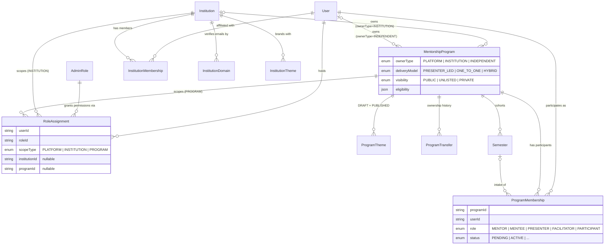
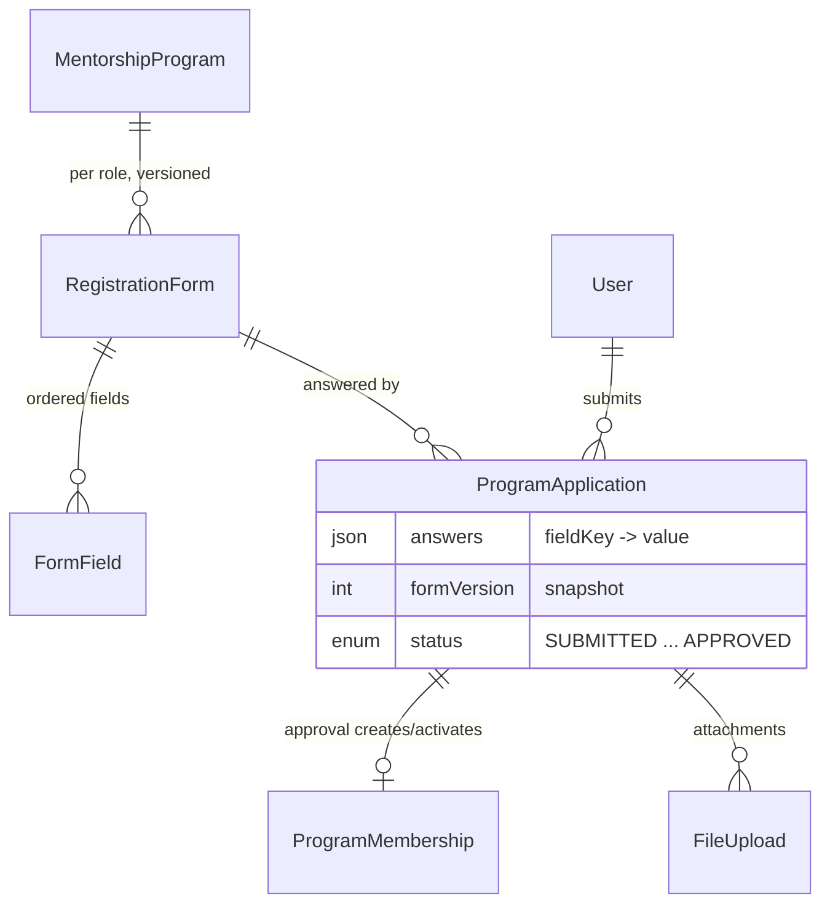
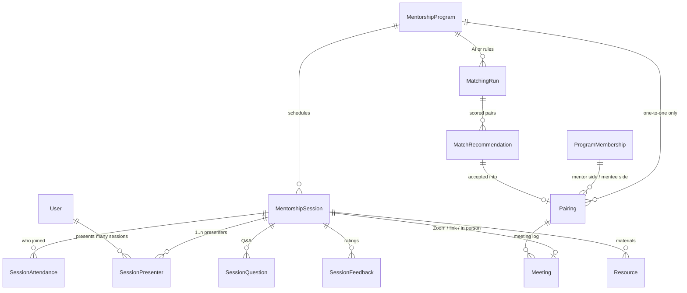
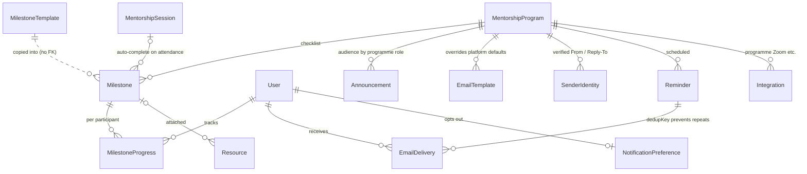
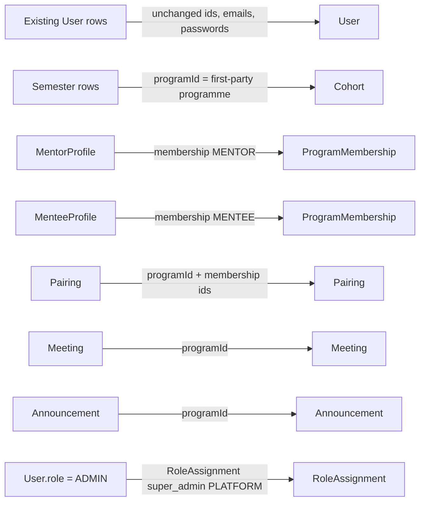

# Phase 0 — Data Model Diagrams

Derived from `03-proposed-schema.prisma`. Split into four views so each stays readable; GitHub
renders these Mermaid blocks directly.

## 1. Tenancy and access

One user, many programmes, different roles: `ProgramMembership` is unique per
`(programId, userId, role)`, so the same `User` can appear as MENTEE in A, MENTOR in B and
PRESENTER + MENTOR in C, while a `RoleAssignment` makes them coordinator of D.

## 2. Registration

## 3. Delivery: presenter-led, one-to-one, hybrid

Presenter-led audience is **implicit**: every ACTIVE membership in the programme may attend
every session. There is no group table and no pre-assignment, which is what keeps it from
turning into small-group mentorship. `SessionAttendance` rows record what actually happened.

Hybrid = both halves at once: sessions for every member, plus `Pairing` rows for the members a
coordinator selects.

## 4. Progress and communications

## Legacy data after migration

